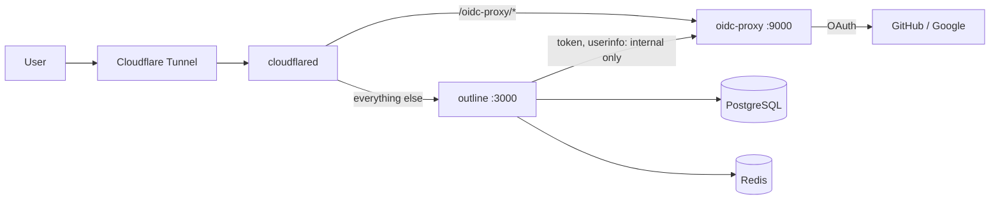

# outline-oidc

A small Docker Compose stack for self-hosting [Outline](https://www.getoutline.com/) (an open-source Notion-style wiki) behind a **GitHub and/or Google login with an email allowlist**, published through a Cloudflare Tunnel.

Outline only speaks OIDC and has no allowlist of its own. This repo adds a tiny OIDC proxy (`oidc-proxy/`) that signs people in with GitHub or Google and lets only the emails you list through. To Outline, the proxy looks like an ordinary OIDC provider.



## Requirements

- Docker with Docker Compose v2, and `openssl`.
- A domain on Cloudflare (for the tunnel and DNS), and a hostname for the wiki, e.g. `docs.example.com`.
- A GitHub OAuth app and/or a Google OAuth client (both free).

## Quick start

```bash
git clone https://github.com/torridfish/outline-oidc.git
cd outline-oidc
./setup.sh docs.example.com     # writes .env with fresh secrets and the allowlist file
```

Then do the three one-time steps below, and run `docker compose up -d`.

### 1. Create a login provider

Fill in at least one pair in `.env`. A provider with an empty client ID is hidden from the login page.

**GitHub** (Settings > Developer settings > OAuth Apps > New OAuth App)

- Homepage URL: `https://docs.example.com`
- Authorization callback URL: `https://docs.example.com/oidc-proxy/github/callback`
- Generate a client secret, then set `GITHUB_OAUTH_CLIENT_ID` and `GITHUB_OAUTH_CLIENT_SECRET`.

**Google** (Google Cloud Console > APIs & Services > Credentials > OAuth client ID, type "Web application")

- Authorized redirect URI: `https://docs.example.com/oidc-proxy/callback`
- Set `GOOGLE_OAUTH_CLIENT_ID` and `GOOGLE_OAUTH_CLIENT_SECRET`.

### 2. Create the tunnel

You need a browser once, for `tunnel login`.

```bash
cf() { docker run --rm -v "$PWD/.cloudflared":/home/nonroot/.cloudflared cloudflare/cloudflared:2026.11.0 "$@"; }
cf tunnel login
cf tunnel create outline                                  # prints the Tunnel ID
cf tunnel route dns outline docs.example.com
cp cloudflared/config.example.yml .cloudflared/config.yml # fill in <TUNNEL_ID> and <DOMAIN>
```

If you change the tunnel name, set `TUNNEL_NAME` in `.env` to match.

### 3. Set the allowlist

Add one email per line to `allowlist/allowed-emails.txt`:

- For GitHub, use the account's **primary verified** email.
- For Google, use the account's Google email.

Edits take effect immediately. The folder is mounted, not the single file, so it works even when an editor replaces the file.

### 4. Start and sign in

```bash
docker compose up -d
```

Open `https://docs.example.com`. **The first person to sign in becomes the admin**, so sign in yourself first.

## Configuration

Everything is in `.env` (see `.env.example`). The ones you may want to change:

| Variable | Purpose |
| --- | --- |
| `DOMAIN` | Public hostname of the wiki |
| `SITE_NAME` | Name shown on the login page |
| `TUNNEL_NAME` | Cloudflare tunnel to run (default `outline`) |
| `DEFAULT_LANGUAGE` | Outline's default UI language, e.g. `en_US`, `zh_TW` |
| `WEB_CONCURRENCY` | Outline worker count; lower it on small machines |

## Operations

```bash
docker compose logs -f outline | oidc-proxy | cloudflared    # pick one service
docker compose pull && docker compose up -d --force-recreate  # update (the Outline version is pinned in docker-compose.yml)
```

Login attempts are logged by the proxy as `ALLOWED (...)` or `DENIED (...)` with the email, which is the first place to look when someone cannot sign in.

### Backup

```bash
./backup.sh
```

This writes `backup/<timestamp>/outline_db.sql.gz` (every document) and `outline_files.tar.gz` (uploads), and deletes backups older than `BACKUP_KEEP_DAYS` (default 14). It never touches git and deletes only its own timestamped folders, so `backup/` can safely be a clone of a private repo. Copy `backup/` off the machine yourself, for example to a **private** repo or object storage. Run it from cron if you want it daily:

```
0 3 * * * /path/to/outline-oidc/backup.sh >> /path/to/outline-oidc/backup.log 2>&1
```

### Restore

Restoring into a database that already has data conflicts, so empty it first. Set `B` to the backup folder.

```bash
B=backup/2026-01-01_030000
docker compose stop outline cloudflared oidc-proxy
docker compose exec -T postgres psql -U outline -d postgres -c "DROP DATABASE outline;"
docker compose exec -T postgres psql -U outline -d postgres -c "CREATE DATABASE outline;"
gunzip -c $B/outline_db.sql.gz | docker compose exec -T postgres psql -U outline outline
gzip -dc $B/outline_files.tar.gz | docker compose run --rm -T --no-deps --entrypoint tar outline -C /var/lib/outline/data -xf -
docker compose up -d
```

### Adopt an existing deployment

Docker names volumes after the Compose project. To reuse the volumes of an older deployment, set `COMPOSE_PROJECT_NAME` in `.env` to its old project name, and keep its `SECRET_KEY`, `UTILS_SECRET`, `POSTGRES_PASSWORD` and `OIDC_PROXY_SIGNING_KEY`. Move its allowlist to `allowlist/allowed-emails.txt`.

## Security notes

- `cloudflared` is the only way in; no container publishes a port. Keep it that way, because the proxy's `/token` and `/userinfo` endpoints are meant to be reachable only from the Outline container. The tunnel config exposes `/oidc-proxy/*` only.
- The proxy checks the allowlist at every sign-in and every token refresh. Removing an email blocks new sign-ins at once, but does not end a session that is already open in Outline; to cut access immediately, also suspend the user in Outline (Settings > Members).
- `OIDC_PROXY_SIGNING_KEY` keeps sessions valid across restarts. Without it the proxy generates a temporary key and everyone is signed out on every restart. `setup.sh` generates one for you.
- The proxy keeps pending logins in memory, so restarting it during someone's sign-in makes that attempt fail once.
- `.env` holds every secret and is gitignored. `backup/` holds your documents and is gitignored too.

## License

[MIT](LICENSE)
